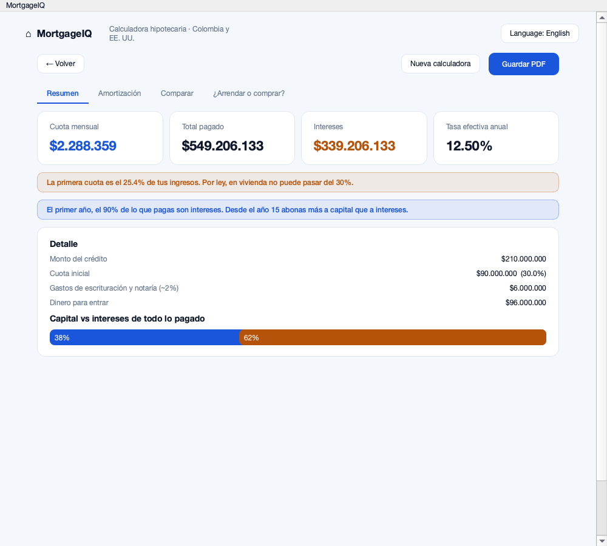
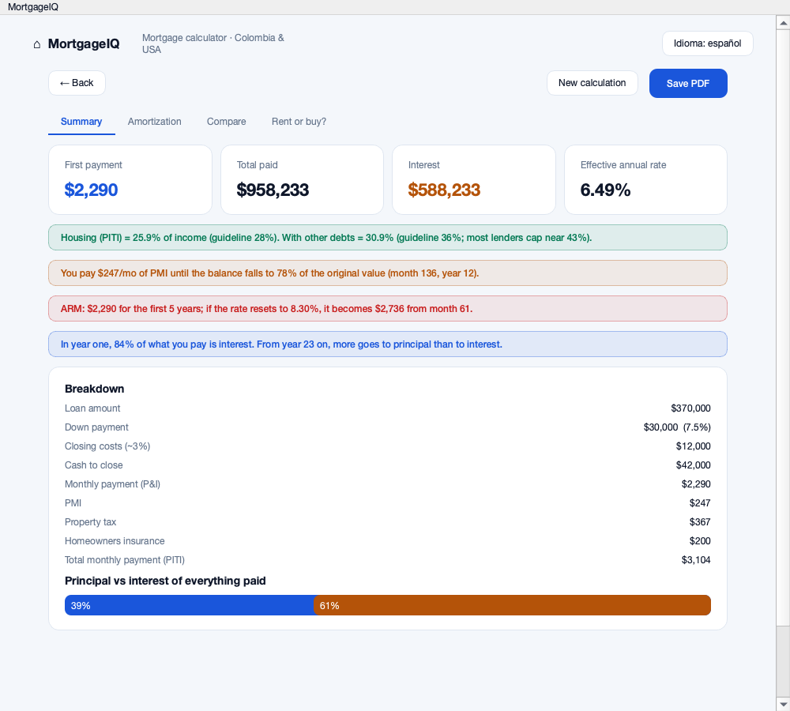

<p align="center">
  
</p>

<h1 align="center">MortgageIQ</h1>

<p align="center">
  <b>A mortgage calculator for Colombia 🇨🇴 and the United States 🇺🇸</b><br>
  Desktop app for macOS and Windows, in Spanish and English.
</p>

<p align="center">
  
  
  
  
</p>

<p align="center"></p>

*Resumen en español: MortgageIQ calcula un crédito hipotecario en Colombia (tasa E.A., pesos o UVR, tope VIS y subsidios, regla del 30% de los ingresos) o en EE. UU. (PMI, FHA, ARM, PITI). Muestra la cuota, el costo total, la tabla de amortización, una comparación entre bancos, si conviene arrendar o comprar, y genera un PDF. Todo se calcula en tu computador.*

## What it does

Pick a country, enter the price, down payment, term and rate. Then you get:

**Colombia**
- **Fixed-peso loans** with the rate read correctly as *efectiva anual* (E.A.)
- **UVR loans:** the payment starts lower and rises with inflation. The app shows the first and last payment and compares the total with a peso loan at the same real rate.
- **Bank rules:** the minimum down payment (20% for VIS, 30% otherwise) and the legal cap that the first payment can't exceed 30% of household income
- **VIS and subsidies:** whether the price is under 150 minimum wages and the income under 4. The minimum wage is a setting you update each January.

**USA**
- **Conventional loans with PMI.** PMI drops automatically when the balance reaches 78% of the original value, and the app tells you which month.
- **FHA:** the 3.5% minimum down, the upfront MIP added to the loan, and annual MIP (for 11 years or the life of the loan)
- **5/1 ARM:** five fixed years, then a reset rate you choose
- **PITI** (principal, interest, property tax and insurance) and front-end and back-end debt-to-income ratios

**Both countries**
- A yearly or monthly **amortization** table
- A **comparison** of reference banks or loan products
- **Rent or buy:** a net-worth comparison over 30 years
- A **PDF** summary
- A **Spanish / English** switch

<p align="center"></p>

## Install

**Download:** the Mac and Windows builds are on [Releases](../../releases).

> On macOS the app isn't notarized yet. The first time, right-click it and choose **Open**.

**From source:**

```bash
git clone https://github.com/ianjacobo2009-hub/mortgageiq.git
cd mortgageiq
python3 -m venv .venv && source .venv/bin/activate
pip install -r requirements.txt
python -m mortgageiq
```

In the **MortgageIQ → Settings** menu you can change the bank and product reference rates, the Colombian minimum wage, closing costs, property tax, insurance, and the PMI and FHA percentages.

## The math

| | Formula |
|---|---|
| Colombia monthly rate | `i = (1 + E.A.)^(1/12) − 1` |
| US monthly rate | `i = APR / 12` |
| Payment | `C = P · i / (1 − (1 + i)^−n)` |
| UVR loan | the schedule is built in UVR units at the real rate, then each month is multiplied by the UVR value `(1 + inflation)^(m/12)` |
| ARM | the payment is recomputed in month 61 on the remaining balance at the new rate |
| Rent vs buy | buyer = home value − balance − 5% to sell + their own investments; renter = down payment and closing costs invested + whatever they save each month |

Run the tests with `pip install pytest && python -m pytest -q`. They cover:

- the E.A. conversion
- schedules that end at zero
- UVR indexation
- the VIS and 30% checks
- when PMI ends
- FHA MIP
- the ARM reset
- the debt-to-income ratios
- rent vs buy

## From prototype to software

MortgageIQ started as a web prototype. This desktop version is a full rewrite that fixes these problems:

1. **The Colombian rate was treated as nominal.** The form asked for an E.A. rate but divided it by 12. At 12.5% E.A. on $210M over 20 years, that made the payment about **$97,500 too high every month** ($2,385,895 instead of $2,288,359), and it showed the "effective rate" as 13.2%.
2. **The UVR option did nothing.** It now models a real UVR loan.
3. **The subsidy check was a fixed $150M cutoff.** It now uses 150 minimum wages and checks income against 4 minimum wages.
4. **The US product comparison used your term for every product,** so the "15-Year Fixed" was priced as 30 years. FHA had no MIP, and the ARM never reset.
5. **The affordability check looked only at principal and interest.** It now uses PITI and other debts in the US, and the legal 30% rule in Colombia.
6. **The rent-vs-buy model ignored the mortgage balance.** It now compares real net worth for both sides.

## Project layout

```
mortgageiq/
  finance.py   rates, schedules, UVR, PMI/FHA/ARM, checks, rent vs buy
  i18n.py      Spanish and English text
  app.py       the desktop interface (PySide6) and the PDF
tests/         tests for the math
```

## Disclaimer

Educational simulation, not a loan offer or financial advice. Reference rates are approximate, so always get the rate and total cost from your lender in writing.

---

Made by **Ian** · [Blue Peak AI & Finance Solutions](https://github.com/ianjacobo2009-hub)
